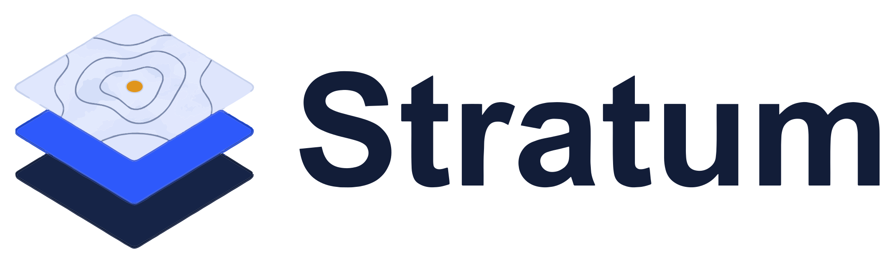
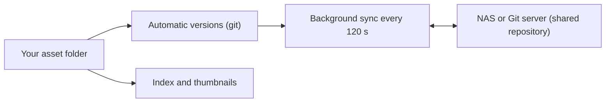
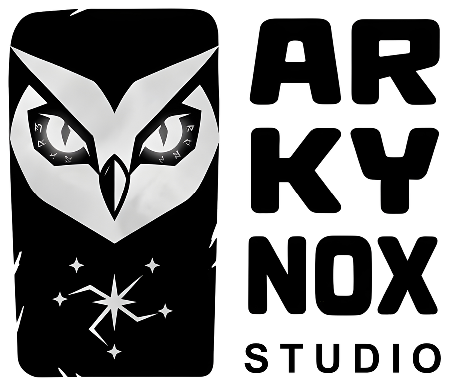

<div align="center">
  <picture>
    <source media="(prefers-color-scheme: dark)" srcset="./branding/stratum-wordmark-dark.svg">
    
  </picture>

  <p><b>Your assets. Every version. Always yours.</b></p>

  <p>Local-first, versioned, searchable asset vault for game studios.</p>

  <p>
    <a href="https://github.com/AkkilMG/Stratum/actions/workflows/ci.yml"></a>
    <a href="https://securityscorecards.dev/viewer/?uri=github.com/AkkilMG/Stratum"></a>
    <a href="https://github.com/AkkilMG/Stratum/releases"></a>
    <a href="LICENSING.md"></a>
    
    <a href="https://tauri.app"></a>
    <a href="CONTRIBUTING.md"></a>
  </p>

  <p>
    <a href="https://github.com/AkkilMG/Stratum/releases"><b>Download</b></a> ·
    <a href="docs/BUILDING.md"><b>Build from source</b></a> ·
    <a href="docs/ARCHITECTURE.md"><b>How it works</b></a> ·
    <a href="CONTRIBUTING.md"><b>Contribute</b></a>
  </p>

  <p>
    <a href="#install">Install</a> ·
    <a href="#features">Features</a> ·
    <a href="#how-it-works">How it works</a> ·
    <a href="#how-stratum-compares">Compare</a> ·
    <a href="#faq">FAQ</a> ·
    <a href="#documentation">Docs</a> ·
    <a href="#trust-signing-and-verification">Signing &amp; trust</a> ·
    <a href="#contributing">Contributing</a> ·
    <a href="#license">License</a>
  </p>
</div>

---

## What is Stratum

Stratum keeps every version of every texture, map, model and source file, finds
assets by what they *look* like, and works fully offline. Nothing is uploaded to anyone's
cloud.

Your studio's assets live on your own machines: a fast working copy on your PC, plus an
optional shared repository on a NAS or Git server for the team. Every change is versioned
automatically in the background — there are no commits and no commands to learn.

Stratum is **free and open source — and it will stay that way.** The full source code is
public, and everyone is welcome to contribute, report bugs, request features and improve
the documentation. New to it? The built-in **60-second tour** walks through every screen
using safe sample files and touches nothing real.

## Why Stratum

Game studios generate thousands of assets. They get renamed, overwritten, lost and
duplicated across drives. Stratum gives a studio one place to keep them:

| The usual mess | With Stratum |
| --- | --- |
| Files get renamed or overwritten, and nobody knows which copy is current | Every save is a version — automatic, in the background, no commits to remember |
| You know what an asset looks like but not what it is called | Search by meaning: "red desert sector map" finds it even if nothing is named that |
| Work stops the moment the network does | Fully offline; sync with a NAS or Git server whenever it is reachable |
| "Cloud" means accounts, telemetry and someone else's disk | No accounts, no telemetry, no cloud. Local AI only |
| PSDs and vector maps get opened just to check them | Real previews: images, SVG maps and PSDs get thumbnails, and local AI suggests tags |

## Screenshots

UI captures are being prepared (tracked in the [roadmap](ROADMAP.md)); they will live in
[`docs/images/`](docs/images/). Until they land, the built-in **60-second tour** shows every
screen against a safe practice space.

<!--
Add captures to docs/images/ and replace this comment with a centred grid, for example:

<div align="center">
  
  
  
  
</div>
-->

## Features

**Versioning**

- Automatic background versioning with Git — every change is a version, with no commits
  and no commands to learn.
- Per-asset version history with author and time, and a side-by-side preview of any older
  version.
- Restore any version as a new version, so going back never destroys anything.
- Conflict-safe: if two people edit the same file, your version stays in place and the
  teammate's is saved next to it as `(conflict from teammate)`. Nothing is overwritten.

**Finding assets**

- Visual **Library** in grid or list layout, with previews for images, SVG vector maps and
  PSD files.
- Sort by recent, name or largest, and filter by file type or tag.
- Keyword search, plus **search by meaning** — describe what you want ("red desert sector
  map") and find it even if nothing is named that.
- Editable tags: a local AI suggests them when a file is added, and you can add or remove
  them. Tags travel with the vault, so teammates see them too.

**Team sync**

- Sync through a shared bare Git repository on a NAS, or any Git server over LAN, VPN or
  WAN (`ssh://` or `https://`).
- Offline-safe: work continues when the NAS is unreachable, and queued changes sync when
  it returns.
- Background sync every 120 seconds, plus a manual **Sync now**.
- Optional Git LFS for servers that provide it (Gitea, GitLab, GitHub).
- Network drives are detected automatically and use a local "safe mode", so the index and
  thumbnails never sit on a slow share.

**Experience**

- Six languages: English, Spanish, Russian, Hindi, French and German.
- First-run wizard for your name, storage setup (this PC · this PC + studio NAS · join a
  teammate), folders and a system check.
- Built-in 60-second tour against a safe practice space, a `Ctrl+K` command palette and
  keyboard shortcuts.
- Light, dark or system theme, and a searchable browser of the open-source licenses
  bundled with the app.
- Signed, in-app auto-updates: installed builds check the signed release feed and update
  without reinstalling.

## Requirements

- **[Git](https://git-scm.com)** — required. Stratum runs the `git` CLI for versioning.
- **[Ollama](https://ollama.com)** — optional. It powers automatic tags and search by
  meaning; without it everything else works and search falls back to keywords.
- **Rust (stable)** and **Node.js 20.19+** — only needed to build from source.

You do not have to install Git or Ollama yourself. The Windows setup offers to download
and install Git for you (and optional Ollama), and Stratum can install both on first run
from the app's own screen. See [Install](#install).

## Install

Prebuilt installers are published on the
[releases page](https://github.com/AkkilMG/Stratum/releases).

| Platform | Package |
| --- | --- |
| Windows | `.exe` setup (NSIS) or `.msi` |
| Linux | `.deb`, `.rpm` or `.AppImage` |
| macOS | `.dmg` (build from source — see below) |

The Windows setup checks for Git and, with your consent, downloads and installs it (and
optional Ollama) for you; it also recommends installing to the C: drive for best
performance. On every platform, if a dependency is still missing the app offers to
install it on first run, and you can always install Git, Git LFS or Ollama later from
**Settings**.

Installed builds update themselves from the signed release feed. CI also commits fresh
builds into [`release/`](release/) whenever the
[build-installers workflow](.github/workflows/build-installers.yml) runs, so the newest
artifacts are always browsable straight from the repository.

## Build from source

**Prerequisites:** Rust (stable), Node.js 20.19+ (see `.nvmrc`), Git, and the
[Tauri v2 system dependencies](https://tauri.app/start/prerequisites/) for your OS.
Optional local AI: `ollama pull llava:7b && ollama pull nomic-embed-text`.

```bash
git clone https://github.com/AkkilMG/Stratum.git
cd Stratum
npm install
npm run tauri dev      # run in development
npm run tauri build    # build installers for your OS
```

Tauri builds installers for the OS it runs on. See [`docs/BUILDING.md`](docs/BUILDING.md)
for platform notes and Linux packages via Docker. CI can build every platform for you: run
the [build-installers workflow](.github/workflows/build-installers.yml) to build all
platforms and commit the installers into `release/`, or the
[release workflow](.github/workflows/release.yml) to publish a tagged release.

## How it works

Open a folder and Stratum runs `git init`, indexes the files, builds thumbnails, tags
images with LLaVA and stores the index in `<vault>/.stratum/index.db`. Drag files or
folders anywhere into the window to import them — they are copied into `Imported/`, then
indexed, previewed, tagged and versioned automatically.



Without Ollama everything still works except semantic search (keyword fallback). See
[`docs/ARCHITECTURE.md`](docs/ARCHITECTURE.md) for the full picture.

### Where should assets live?

- **This PC only** — simplest and fastest.
- **This PC + NAS (recommended for teams)** — a fast local working copy plus a shared bare
  Git repository on the NAS (or any SSH/HTTPS Git server over LAN/VPN/WAN). Offline-safe;
  syncs in the background.
- **Join** — clone an existing studio vault.

The index database and thumbnails always stay on the local machine. Network drives are
detected automatically and use polling plus a local git directory.

## How Stratum compares

| | Stratum | Cloud asset manager | Plain Git |
| --- | --- | --- | --- |
| Previews for images, SVG maps and PSDs | Built in | Built in | None |
| Version history | Automatic, every change | Vendor-defined | Manual commits |
| Works offline | Yes | No | Yes |
| Accounts or telemetry | None | Usually required | None |
| Search by meaning | Local AI (optional) | Vendor cloud AI | No |
| Where your data lives | Your disk, NAS or server | Vendor cloud | Your disk |
| Cost | Free | Usually a subscription | Free |

## FAQ

**Is Stratum free?** Yes. It is free and open source, and it is intended to stay free.
See the [Stratum Community License](LICENSE.txt).

**Does Stratum send my data anywhere?** No. There are no accounts, no telemetry and no
cloud. Your files stay on your machine, your NAS or your own Git server, and local AI runs
on your computer. See the [privacy policy](legal/PRIVACY.md).

**Do I need a NAS?** No. "This PC only" is the simplest setup; a NAS (or any Git server)
is optional and useful for teams.

**Do I need to install Git myself?** No. Stratum needs Git, but the Windows setup and the
app's first-run check both offer to download and install it for you. If you prefer, install
Git from [git-scm.com](https://git-scm.com) beforehand and Stratum will use it.

**Do I need Ollama?** No. It powers automatic tags and search by meaning; without it
everything else works and search falls back to keywords.

**Is my version history a backup?** No. Version history lives with your files and can be
lost with the same disk, so keep independent backups.

More answers in [`docs/FAQ.md`](docs/FAQ.md).

## Trust, signing and verification

Installers are built in public CI and published on
[GitHub Releases](https://github.com/AkkilMG/Stratum/releases). Every release ships a
Software Bill of Materials and SLSA build-provenance attestations that anyone can verify:

```bash
gh attestation verify ./Stratum_0.1.0_x64-setup.exe --repo AkkilMG/Stratum
```

Stratum is **free and open source at $0 cost**, so it uses free trust paths: SignPath
Foundation for Windows (once approved), ad-hoc signing for macOS, and store builders for
Linux. Installed builds update themselves from the signed release feed.

Backend errors are reduced to stable, translatable codes, so file paths, host names and
credentials never reach the interface.

- [`docs/CERTIFICATION.md`](docs/CERTIFICATION.md) — how trust is established on each
  platform.
- [`docs/DISTRIBUTION.md`](docs/DISTRIBUTION.md) — packaging, stores and package managers.
- [`docs/SUPPLY-CHAIN.md`](docs/SUPPLY-CHAIN.md) — SBOM, SBOM/provenance attestations and
  verification.
- [`packaging/`](packaging/) — manifests for winget, Scoop, Chocolatey, Homebrew, Flatpak,
  Snap, AUR and MSIX.

## Documentation

| Document | Covers |
| --- | --- |
| [`docs/ARCHITECTURE.md`](docs/ARCHITECTURE.md) | How the vault, index and sync layers fit together |
| [`docs/DEVELOPMENT.md`](docs/DEVELOPMENT.md) | Development setup, code layout and conventions |
| [`docs/BUILDING.md`](docs/BUILDING.md) | Platform build notes and Linux packages via Docker |
| [`docs/FAQ.md`](docs/FAQ.md) | The questions people ask first |
| [`docs/DISTRIBUTION.md`](docs/DISTRIBUTION.md) | Packaging, stores and package managers |
| [`docs/CERTIFICATION.md`](docs/CERTIFICATION.md) | Platform trust and signing |
| [`docs/SUPPLY-CHAIN.md`](docs/SUPPLY-CHAIN.md) | SBOM, provenance and verification |
| [`docs/TRANSLATING.md`](docs/TRANSLATING.md) | Adding or fixing a translation |
| [`CHANGELOG.md`](CHANGELOG.md) | What has shipped, per release |
| [`ROADMAP.md`](ROADMAP.md) | Where the project is heading |
| [`SUPPORT.md`](SUPPORT.md) | How to get help |

## Roadmap and status

Stratum is at **v0.1.0** — usable every day, still moving fast. Near-term work:

- Screenshots and a short demo video in the README (the section above is reserved for
  them).
- More automated tests for the Rust backend (indexing, versioning, sync).
- Better first-run onboarding and error messages.
- Performance work on very large vaults (100k+ assets).
- Signed Windows and macOS builds, and a Linux AppImage with auto-update.

See [`ROADMAP.md`](ROADMAP.md) for the full plan and [`CHANGELOG.md`](CHANGELOG.md) for
what has already shipped.

## Contributing

All contributions are welcome — code, documentation, translations, bug reports and feature
ideas. You do not need to be part of any team to help.

- Read [`CONTRIBUTING.md`](CONTRIBUTING.md) to get started.
- Please follow our [`CODE_OF_CONDUCT.md`](CODE_OF_CONDUCT.md).
- Report security issues privately as described in [`SECURITY.md`](SECURITY.md).
- Improve the docs in [`docs/`](docs/), starting with [`docs/FAQ.md`](docs/FAQ.md) and
  [`docs/TRANSLATING.md`](docs/TRANSLATING.md).
- Browse [good first issues](https://github.com/AkkilMG/Stratum/labels/good%20first%20issue)
  if you are new.

When you modify Stratum, please clearly mark your version as a modification of Stratum and
link back to this repository.

## License

Stratum is **dual-licensed** — you may use it under the **Stratum Community License** *or*
the **Apache License 2.0**, at your choice. In short: free to use, study, modify and share.
The Community License adds a no-resale clause and asks forks to stay honest about being
modifications of Stratum; **Apache-2.0** is the permissive, OSI-approved alternative (with a
patent grant) for anyone who needs it.

See [`LICENSING.md`](LICENSING.md) for how to choose, [`LICENSE.txt`](LICENSE.txt) for the
Community License, [`LICENSE-APACHE.txt`](LICENSE-APACHE.txt) for Apache-2.0, and
[`TRADEMARK.md`](TRADEMARK.md) for brand usage.

Stratum includes open-source components under their own licenses. See
[`THIRD_PARTY_NOTICES.txt`](THIRD_PARTY_NOTICES.txt) or the in-app **Licenses** screen.

## Credits

Stratum is a product of [Arkynox](https://arkynox.com), developed by
[Akkil M G (@AkkilMG)](https://github.com/AkkilMG).

Built on [Tauri 2](https://tauri.app) and [Ollama](https://ollama.com), versioned with plain
`git`.

---

<p align="center">
  <picture>
    <source media="(prefers-color-scheme: dark)" srcset="./branding/arkynox-studio-dark.png">
    
  </picture>
</p>

<p align="center">
  <a href="https://github.com/AkkilMG/Stratum">Repository</a> ·
  <a href="https://arkynox.com">Website</a> ·
  <a href="https://github.com/AkkilMG/Stratum/issues/new/choose">Issues</a>
</p>
